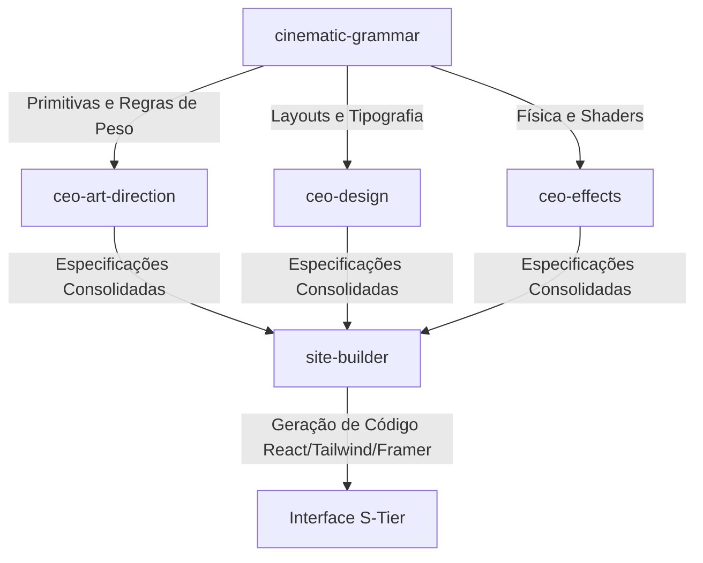

# Sistema de Gramática Cinematográfica e Cinética (Cinematic Grammar)
**Status:** Produção — S-Tier  
**Domínio:** Infraestrutura Criativa Transversal  
**Referência:** Mad Lab Aurora / Elysian Corp

---

## 1. Visão Geral e Justificativa

O **Sistema de Gramática Cinematográfica e Cinética** foi projetado para livrar o ecossistema do Mad Lab Aurora do visual clichê associado a sites de IA ("AI-generated look"). Em vez de simplesmente copiar e colar prompts brutos, a inteligência criativa da Aurora agora opera sob um **motor sintático generativo**, que desconstrói referências estéticas S-Tier em primitivas combinatórias de 8 dimensões.

Estas primitivas são recalibradas de acordo com as regras de **Dark Editorial** e de **Peso Visual (Weight Score)**, garantindo que as interfaces geradas sejam elegantes, assimétricas, cinematicamente ricas e tecnicamente otimizadas.

---

## 2. O Que Foi Feito (Entregas Físicas)

A infraestrutura foi totalmente integrada ao repositório local sob o caminho de habilidades globais do Mad Lab Aurora:

1. **Relocação da Skill `ceo-art-direction`:**
   - Movida de `ElysianCorp/` para o diretório transversal: [ceo-art-direction](file:///C:/Projetos/MadLabAurora/.aurora/skills/ceo-art-direction).
   - Validada com suporte a Art Production Reports e prompts estruturados.
2. **Nova Habilidade `cinematic-grammar`:**
   - Criada em: [cinematic-grammar](file:///C:/Projetos/MadLabAurora/.aurora/skills/cinematic-grammar).
   - Contém a definição operacional em [SKILL.md](file:///C:/Projetos/MadLabAurora/.aurora/skills/cinematic-grammar/SKILL.md).
3. **Ingestão do Corpus de Originais:**
   - Compilação de 49 landing pages e heros ricos em [CORPUS-MASTER.md](file:///C:/Projetos/MadLabAurora/.aurora/skills/cinematic-grammar/raw-vault/CORPUS-MASTER.md) (~351 KB de prompts brutos de design e animação).
4. **Análise de Frequência:**
   - Criado o arquivo [frequency-analysis.md](file:///C:/Projetos/MadLabAurora/.aurora/skills/cinematic-grammar/references/frequency-analysis.md) quantificando os padrões dominantes nos sites S-Tier (ex: Tipografia Oversized a 92%, Transição Staggered a 85%, Liquid Glass a 77%).
5. **Regras Sintáticas e de Combinação:**
   - [generative-grammar.md](file:///C:/Projetos/MadLabAurora/.aurora/skills/cinematic-grammar/references/generative-grammar.md): Define a **Fórmula de Peso Visual (Weight 1-10)** e padrões de intertravamento (como a *Regra de Refração* e a *Regra do Oposto Complementar*).
   - [dna-filter.md](file:///C:/Projetos/MadLabAurora/.aurora/skills/cinematic-grammar/references/dna-filter.md): Filtro que aprova padrões forenses, rejeita ativamente SaaS clichês (gradientes neon roxo-azul-verde, cards simétricos, bounce/elastic effects) e calibra comportamentos condicionais.
6. **Catálogo de Primitivas (8 Dimensões):**
   - Pasta [primitives](file:///C:/Projetos/MadLabAurora/.aurora/skills/cinematic-grammar/primitives/): 8 arquivos contendo primitivas formatadas em YAML (ex: `motion.md`, `camera.md`, `composition.md`, `lighting.md`, `interaction.md`, `atmosphere.md`, `transition.md`, `narrative.md`).
7. **Motor de Síntese e Exemplo Executável:**
   - [synthesis.md](file:///C:/Projetos/MadLabAurora/.aurora/skills/cinematic-grammar/synthesis.md): Protocolo de compilação de especificações.
   - [test-spec-m6.md](file:///C:/Projetos/MadLabAurora/.aurora/skills/cinematic-grammar/examples/test-spec-m6.md): Um exemplo de spec gerada e aprovada pelo protocolo de QA.

---

## 3. Distribuição de Papéis pelos Agentes (Para Quem Serve)

Este sistema atua de forma transversal, servindo como uma "biblioteca compartilhada de lógica visual" para os seguintes agentes do ecossistema Mad Lab Aurora:



### 🎯 Agente `ceo-art-direction`
- **Função:** Ler as primitivas de iluminação (`lighting.md`) e atmosfera (`atmosphere.md`) para gerar prompts artísticos precisos e coerentes (Midjourney/Stable Diffusion/vídeos).
- **Consumo:** Utiliza as regras de contraste (ex: Chiaroscuro `LGT-001`) e filtros de textura (ex: Halftone Grain `ATM-001`) para criar direções de arte coerentes com o DNA Elysian.

### 🎨 Agente `ceo-design`
- **Função:** Utilizar as primitivas de composição (`composition.md`) e narrativa (`narrative.md`) para estruturar a hierarquia visual pós-hero e a tipografia das seções.
- **Consumo:** Enforca o Split Assimétrico (`COM-002`), o Grid de Diagnóstico (`COM-003`), a tipografia display colossal com `clamp()` (`COM-005`), e a escala de densidade (EQ de Frequências).

### 🎬 Agente `ceo-effects`
- **Função:** Traduzir as primitivas de movimento (`motion.md`), transições (`transition.md`), câmera (`camera.md`) e interação (`interaction.md`) em animações e shaders reativos.
- **Consumo:** Controla o Lerp em cursor magnético (`INT-001`), o parallax multicamadas (`CAM-003`), o deslocamento de ruído fractal de scroll (`MOT-005`) e respeita rigorosamente o budget de performance de frames da GPU e acessibilidade (`prefers_reduced_motion`).

### 🛠️ Agente `site-builder`
- **Função:** Receber as especificações consolidadas geradas pelos CEOs e escrever o código real (React, Tailwind CSS, GSAP e Framer Motion).
- **Consumo:** Utiliza as especificações executáveis (como staggers, easings, blur shaders, timings e offsets de scroll) diretamente no desenvolvimento dos componentes.

---

## 4. Como Usar (Protocolo Operacional)

Existem duas formas principais de interagir com esta skill: **Ingestão/Extração** e **Síntese/Composição**.

### 📥 Ingestão de Referências Externa (`/extract-grammar`)
Se você tiver um prompt rico, um design system de referência ou um log técnico e quiser catalogá-lo no sistema, use o comando:
```text
/extract-grammar --source [Origem, ex: Awwwards] --prompt [Conteúdo do prompt]
```
**O que a skill faz internamente:**
1. Salva o prompt bruto em `raw-vault/MS-[SEQ].md`.
2. Filtra as técnicas com base em `references/dna-filter.md`.
3. Adiciona as técnicas aprovadas e calibradas às tabelas YAML correspondentes em `primitives/{dimensao}.md`.
4. Atualiza o contador de frequências em `references/frequency-analysis.md`.

### 🎛️ Síntese de Specs de Design (Synthesis Engine)
Quando for criar uma nova página ou seção:
1. **Defina o Peso Visual (Weight Score):** 
   - *1-3 (Respiro):* Off-white, estático, espaçamento macio.
   - *4-7 (Tensão/Conteúdo):* Chiaroscuro sutil, cursor magnético, grid fino.
   - *8-10 (Hero/Clímax):* Tipografia gigante, Liquid Glass refrativo, staggers de entrada coreografados.
2. **Selecione as Primitivas:** Escolha IDs das primitivas catalogadas (ex: `MOT-002` + `COM-005` + `LGT-001` + `ATM-002`).
3. **Aplique as Regras de Intertravamento:**
   - *Liquid Glass (ATM-002)* **exige** *Scroll Parallax (CAM-003)* no fundo com velocidades diferentes.
   - *Tipografia colossal* **exige** *movimentos lentos e sem bounce*.
   - *Fundo frio* **exige** *glow ou spotlight com cor de acento quente sutil* (ex: âmbar/coral).
4. **Compile o Synthesis Report:** Siga o template contido em `synthesis.md` para gerar o relatório consolidado com o código Framer Motion / GSAP executável.

---

## 5. Resultados Esperados

Ao utilizar esta gramática, o ecossistema produz os seguintes resultados de forma previsível e auditável:

* **Originalidade Radical (Zero AI Look):** Redução completa de layouts genéricos de 3 colunas, botões azuis brilhantes redondos e backgrounds estéreis pretos sem textura.
* **Consistência de Marca Automática:** Todas as interfaces geradas pelos agentes compartilham o mesmo DNA Dark Editorial da marca Elysian (peso tipográfico serif display, off-white, obsidian com grão halftone, acento dourado/âmbar único).
* **Física e Fluidez Cinética:** Elementos reativos ao cursor e ao scroll com interpolações lerp físicas reais e decay exponencial, eliminando movimentos artificiais "elásticos".
* **Código Altamente Otimizado:** Menor carga na CPU/GPU ao usar estritamente transforms acelerados (`translateY`, `scale`, `opacity`) e shader arrays otimizados.
* **Acessibilidade Nativa:** Integração obrigatória de fallbacks estáticos para usuários com preferências de redução de movimento (`prefers-reduced-motion: reduce`).
